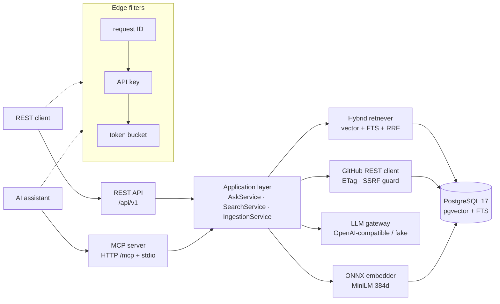

# RepoLens

[](https://github.com/vishweshpenkar06/RepoLens/actions/workflows/ci.yml)
[](LICENSE)
[](https://openjdk.org/projects/jdk/25/)
[](https://spring.io/projects/spring-boot)

> **Measured:** hybrid retrieval hit@6 **92.9%** vs 87.5% vector-only (72 cases); real-model answers with **100% citation validity**, **3.6% false refusals**, **100% refusal recall**, **90% grounded**; search **2,281 req/s at p95 4 ms** after the hot-path fixes.

RepoLens is a self-hosted Java service that ingests a GitHub repository's documentation and
issues, then answers questions about it with **verified citations**, either through a REST API or
as an **MCP server** that AI assistants (Claude Desktop, IDE agents, custom clients) can plug into.

It runs with **no paid embedding key**: embeddings are computed locally with ONNX
(all-MiniLM-L6-v2, 384 dimensions). The chat model is pluggable — a deterministic fake for tests and
demos, or any OpenAI-compatible endpoint for real answers.

- **Hybrid retrieval** over pgvector + PostgreSQL full-text search, fused with Reciprocal Rank
  Fusion (RRF, k = 60), with measured evaluation numbers rather than vibes.
- **Grounded answers** that cite `[n]` context blocks, refuse when evidence is missing, and defend
  against prompt injection in retrieved text.
- **Production concerns**: virtual threads, bounded concurrency, incremental ingestion, caching,
  hashed API keys, rate limiting, request IDs, metrics, dashboards, load tests, CI, and a non-root
  container image.

### 30-second demo

[](docs/demo.cast)

*Real Groq answer with citations; the recording is reproducible with [`scripts/demo.sh`](scripts/demo.sh).*

---

## Contents

- [Features](#features)
- [Architecture](#architecture)
- [Tech stack](#tech-stack)
- [Quickstart](#quickstart)
- [Configuration](#configuration)
- [REST API](#rest-api)
- [MCP server](#mcp-server)
- [How ingestion works](#how-ingestion-works)
- [How retrieval and answering work](#how-retrieval-and-answering-work)
- [Evaluation](#evaluation)
- [Benchmarks](#benchmarks)
- [Observability](#observability)
- [Security](#security)
- [Deployment](#deployment)
- [Project structure](#project-structure)
- [Development](#development)
- [Limitations](#limitations)
- [Roadmap](#roadmap)
- [Documentation](#documentation)
- [License](#license)

---

## Features

| Area | What you get |
|---|---|
| Ingestion | README, top-level markdown, `docs/**/*.md`, and up to 300 issues; ETag + content-hash incremental re-index; removal detection |
| Chunking | Heading-aware sections with `heading_path`, 500-token target / 800 hard max, ~12% overlap, code fences and tables preserved |
| Embeddings | Local ONNX MiniLM (384d), batched on virtual threads with a configurable semaphore |
| Retrieval | Vector cosine (HNSW), Postgres full-text (`ts_rank_cd`), parallel execution, RRF fusion with per-retriever ranks |
| Answering | Grounded prompt with numbered untrusted-data blocks, structured JSON output, citation verification, refusal, SSE streaming |
| Caching | Query-embedding cache and answer cache keyed by `(repoId, contentVersion, question, topK)` |
| MCP | Four tools over streamable HTTP and stdio, LLM-oriented descriptions, untrusted-content delimiters |
| Security | SSRF guard, hashed/revocable API keys, fail-closed auth, per-key token-bucket limits, prompt-injection defenses |
| Observability | Micrometer/Prometheus metrics, Grafana dashboard, structured JSON logs with request IDs, readiness including the embedding model |
| Quality | 188 tests, Testcontainers, WireMock, JaCoCo gates, Spotless, gitleaks, Dependabot, k6 load tests, 72-case eval harness with real-model run |
| Packaging | Multi-stage Dockerfile, non-root uid 1001, read-only rootfs, healthcheck, GHCR publishing, Compose stacks for dev and prod |

## Architecture



**Package-by-feature, single Maven module:**

| Package | Responsibility |
|---|---|
| `api` | REST controllers, DTOs, RFC 7807 error handling |
| `mcp` | MCP tool definitions |
| `ingest` | GitHub client, SSRF guard, chunker, ingestion service/job runner, JDBC stores |
| `embed` | `Embedder` abstraction, ONNX implementation, health indicator |
| `retrieve` | Vector search, keyword search, RRF, retriever, search results |
| `answer` | Prompt builder, LLM gateway, parser, citation verifier, caches, ask service |
| `ratelimit` | Token bucket, scoped registry, filter |
| `security` | API key service/filter, request-id filter, bootstrap |
| `observability` | Micrometer metrics |
| `config` | Typed configuration properties |
| `common` | Hashing utility |

### Request flows

**Ingestion:** `POST /repos` validates the URL (SSRF guard), inserts the repository and job, and
returns `202`. A virtual-thread runner fetches the tree and documents with ETags, chunks changed
documents, embeds batches with bounded concurrency, writes each document transactionally, deletes
documents no longer present, computes `content_version`, and marks the repo `READY` or `FAILED`.

**Search:** embed the query (cached) → vector search and FTS run in parallel on virtual threads →
RRF fuses ranks → top-k chunks with snippets, URLs, scores, and both ranks.

**Ask:** validate question and clamp `topK` → answer-cache lookup → retrieve context → build a
prompt with untrusted-data delimiters and `[n]` blocks → call the LLM → parse JSON → verify citations
and strip invalid markers (refuse on zero valid citations or system-prompt leakage) → cache, log,
return `answer`, `citations`, `refused`, `latencyMs`, `cached`. SSE uses a plain-text prompt variant
and emits `token` events plus a final JSON event.

## Tech stack

Versions verified against Maven Central and official docs; rationale in
[`docs/DECISIONS.md`](docs/DECISIONS.md).

| Component | Version |
|---|---|
| Java | 25 (LTS; Boot supports 17–27) |
| Spring Boot | 4.1.2 |
| Spring AI | 2.0.2 (ONNX Transformers embeddings) |
| MCP Java SDK | 2.1.0 (via Spring AI) |
| PostgreSQL + pgvector | 17 + 0.8.7 (`pgvector/pgvector:0.8.7-pg17`) |
| Migrations / SQL | Flyway + Spring `JdbcClient` |
| Cache | Caffeine 3.3.1 |
| Observability | Micrometer, Prometheus 3.16.0, Grafana 13.3.1 |
| Tests | JUnit 5, AssertJ, Mockito, Testcontainers, WireMock |
| Load | k6 2.4.0 |
| Build | Maven wrapper 3.10.0, Spotless, JaCoCo |

## Quickstart

Prerequisites: JDK 21+ (25 recommended for development), Docker with the Compose plugin. No global
Maven is needed.

### Full stack with Docker

```bash
git clone https://github.com/vishweshpenkar06/RepoLens.git
cd RepoLens
cp .env.example .env
# set REPOLENS_API_KEY to a random value: openssl rand -hex 32
docker compose up -d
curl localhost:8081/actuator/health/readiness
```

The first start downloads the ~90 MB ONNX model into the `onnxdata` volume; readiness stays down
until the model loads. For local experiments only, Compose falls back to
`demo-key-change-me` when `REPOLENS_API_KEY` is empty. Set a real key before exposing anything.

Local services:

| Service | URL |
|---|---|
| App | http://localhost:8081 |
| Postgres + pgvector | `localhost:55432` (`repolens` / `repolens`) |
| Prometheus | http://localhost:9090 |
| Grafana | http://localhost:3001 (`admin` / `GRAFANA_PASSWORD`; local fallback `local-dev-only-change-me`) |

Host ports are remapped because 5432/8080/3000 may already be in use; see
[`docs/ENVIRONMENT.md`](docs/ENVIRONMENT.md).

### Run the app on the host

```bash
docker compose up -d postgres
export REPOLENS_API_KEY=$(openssl rand -hex 32)
./mvnw verify
./mvnw spring-boot:run
```

### First ingestion, search, and answer

```bash
export REPOLENS_API_KEY=...   # the same value the app bootstrapped

# Register a repository (async); returns 202 with repoId and jobId
curl -s -X POST localhost:8081/api/v1/repos \
  -H "X-API-Key: $REPOLENS_API_KEY" -H 'Content-Type: application/json' \
  -d '{"url":"https://github.com/encode/httpx"}'

# Poll until status is READY
curl -s localhost:8081/api/v1/repos/1 -H "X-API-Key: $REPOLENS_API_KEY"

# Hybrid search
curl -s "localhost:8081/api/v1/repos/1/search?q=timeouts&k=6" \
  -H "X-API-Key: $REPOLENS_API_KEY"

# Grounded answer with citations (fake LLM by default)
curl -s -X POST localhost:8081/api/v1/repos/1/ask \
  -H "X-API-Key: $REPOLENS_API_KEY" -H 'Content-Type: application/json' \
  -d '{"question":"How do I configure timeouts?","topK":6}'

# SSE streaming
curl -N "localhost:8081/api/v1/repos/1/ask/stream?question=How%20do%20I%20configure%20timeouts%3F&topK=6" \
  -H "X-API-Key: $REPOLENS_API_KEY"
```

A reproducible terminal demo is in [`scripts/demo.sh`](scripts/demo.sh) and
[`docs/DEMO.md`](docs/DEMO.md).

## Configuration

Every value has a default and can be overridden by environment variables. Start from
[`.env.example`](.env.example).

### Core

| Variable | Default | Purpose |
|---|---|---|
| `SERVER_PORT` | `8081` | HTTP port |
| `DB_URL` | `jdbc:postgresql://localhost:55432/repolens` | JDBC URL (Compose uses `postgres:5432`) |
| `DB_USERNAME` / `DB_PASSWORD` | `repolens` | database credentials |
| `GITHUB_TOKEN` | empty | raises GitHub API limits during ingestion; never logged |
| `GITHUB_ISSUES_ENABLED` | `true` | ingest issues (up to 300) |
| `EMBEDDING_PROVIDER` | `transformers` | Spring AI embedding selector (`none` for tests) |
| `EMBEDDING_CACHE_DIR` | `${java.io.tmpdir}/repolens-onnx` | ONNX model cache |
| `EMBEDDING_MODEL_URI` / `EMBEDDING_TOKENIZER_URI` | Hugging Face MiniLM URLs | alternative model artifacts (384 dims required) |

### LLM

| Variable | Default | Purpose |
|---|---|---|
| `LLM_PROVIDER` | `fake` | `fake` or any name for the OpenAI-compatible gateway (`openai`, `ollama`, ...) |
| `LLM_BASE_URL` | `https://api.openai.com/v1` | chat-completions base URL |
| `LLM_API_KEY` | empty | provider key; omitted header when blank (Ollama) |
| `LLM_MODEL` | empty | required for non-fake providers |
| `LLM_FAKE_LATENCY` | `0ms` | simulated fake latency, used by load tests (`300ms`) |

OpenAI-compatible covers OpenAI, OpenRouter, Groq, Together, vLLM, LM Studio, and Ollama `/v1`.
Anthropic's native API is intentionally not wired (ADR-0017). Groq example:

```bash
LLM_PROVIDER=groq
LLM_BASE_URL=https://api.groq.com/openai/v1
LLM_MODEL=openai/gpt-oss-120b
LLM_API_KEY=<your key>
```

Keys live in `.env` (gitignored) or the environment only.

### Security and limits

| Variable | Default | Purpose |
|---|---|---|
| `REPOLENS_API_KEY` | empty | bootstrap key; only its SHA-256 hash is stored |
| `REPOLENS_API_KEY_REQUIRED` | `true` | require `X-API-Key` on `/api/*` and `/mcp` |
| `RATE_LIMIT_ENABLED` | `true` | token-bucket limiting |
| `RATE_LIMIT_ASK_CAPACITY` / `..._ASK_REFILL` | `10` / `0.5` | `/ask` burst / tokens per second |
| `RATE_LIMIT_SEARCH_CAPACITY` / `..._SEARCH_REFILL` | `30` / `5` | `/search` burst / refill |
| `RATE_LIMIT_GENERAL_CAPACITY` / `..._GENERAL_REFILL` | `60` / `10` | other API and MCP calls |
| `DB_POOL_SIZE` / `DB_MIN_IDLE` | `20` / `5` | main Hikari pool for repositories and FTS |
| `VECTOR_POOL_SIZE` | `10` | dedicated iterative-HNSW pool for vector search |
| `REPOLENS_API_KEY_CACHE_TTL` | `60s` | auth cache TTL (`0s` disables; revocation is delayed by this) |

### Tuning (`application.yml`, `repolens.*`)

| Property | Default | Meaning |
|---|---|---|
| `embedding.concurrency` | `2` | max concurrent ONNX batches (CPU-bound) |
| `embedding.batch-size` | `32` | texts per embedding call |
| `github.max-file-bytes` | `1048576` | skip larger documents |
| `retrieval.candidates` | `30` | per-retriever candidates before fusion |
| `retrieval.top-k` | `6` | default result count |
| `retrieval.rrf-k` | `60` | RRF constant |
| `ask.timeout` | `20s` | configured ask budget; retrieval stages are currently bounded at 15 s (end-to-end deadline is backlog) |
| `ask.max-question-length` | `1000` | question/query cap |
| `ask.top-k-max` | `12` | hard `topK` cap |
| `cache.answer-ttl` / `answer-max-size` | `1h` / `10000` | answer cache |
| `cache.embedding-ttl` / `embedding-max-size` | `24h` / `10000` | query embedding cache |

## REST API

Full request/response documentation: [`docs/API.md`](docs/API.md).

| Method | Path | Purpose |
|---|---|---|
| `POST` | `/api/v1/repos` | register `https://github.com/{owner}/{name}`, start async ingestion |
| `GET` | `/api/v1/repos` | list repositories with status and latest job |
| `GET` | `/api/v1/repos/{id}` | repository detail + latest job |
| `POST` | `/api/v1/repos/{id}/reindex` | incremental re-ingest |
| `GET` | `/api/v1/repos/{id}/search?q=&k=` | hybrid search |
| `POST` | `/api/v1/repos/{id}/ask` | grounded answer with citations |
| `GET` | `/api/v1/repos/{id}/ask/stream` | SSE token stream + final JSON event |

All errors use RFC 7807 `ProblemDetail`. `X-API-Key` is required except for `/actuator/health`
and `/actuator/prometheus` (protect Prometheus at the network layer). Responses carry
`X-Request-Id` and `RateLimit-Limit` / `Remaining` / `Reset` / `Scope`; 429s also send
`Retry-After`.

Constraints: only `https://github.com/{owner}/{name}`; question max 1,000 chars; `topK` clamped
1..12; `POST /repos` returns `409` for duplicates.

## MCP server

Four tools are exposed over **streamable HTTP** at `/mcp` (requires `X-API-Key`) and over **stdio**
(local process, no HTTP key):

| Tool | Inputs | Output |
|---|---|---|
| `list_repositories` | none | repos with id, slug, status |
| `search_docs` | `repo` (`owner/name`), `query`, `limit` | ranked snippets, URLs, fused score, ranks |
| `ask_repo` | `repo`, `question` | grounded answer, citations, `refused`, `cached` |
| `get_document` | `repo`, `path` or `issue-N` | full document text, capped at 20,000 chars |

Retrieved text is wrapped in `<<<UNTRUSTED_DOCUMENT>>> ... <<<END_UNTRUSTED_DOCUMENT>>>` so an
assistant treats it as data, not instructions. Tool descriptions are written for LLM readers.

Claude Desktop (stdio) config, generic HTTP client examples, and transport details:
[`docs/MCP_SETUP.md`](docs/MCP_SETUP.md). Stdio mode keeps logs on stderr
(`--logging.config=classpath:logback-stdio.xml`) so stdout stays pure JSON-RPC.

## How ingestion works

1. Validate `https://github.com/{owner}/{name}` with the SSRF guard: no credentials, ports, query,
   or fragments; resolve `github.com` and reject non-public addresses; HTTP client never follows
   redirects.
2. Fetch repository metadata, the recursive tree, then README, top-level markdown,
   `docs/**/*.md`, and up to 300 issues (pull requests filtered out). Optional `GITHUB_TOKEN`,
   rate-limit backoff, ETags.
3. `MarkdownChunker` splits on headings, records `heading_path`, strips badges/HTML noise, keeps
   tables and fenced code blocks intact where possible, targets 500 tokens with ~12% overlap and a
   hard max of 800.
4. Changed documents run on virtual threads; embedding calls are batched and bounded by a
   semaphore because ONNX inference is CPU-bound.
5. Each document is written in its own transaction (upsert document + replace chunks). Documents no
   longer present are deleted. `content_version` is a SHA-256 over all `(kind|path=hash)` pairs, so
   answer caches invalidate automatically on re-ingest.
6. Job and repository status update to `READY` or `FAILED` with the error captured.

Sources are documentation and issues only; source code is not indexed.

## How retrieval and answering work

**Retrieval.** Vector search uses `1 - (embedding <=> query)` over an HNSW cosine index, filtered by
repository and limited to 30 candidates. Keyword search uses
`ts_rank_cd(fts, websearch_to_tsquery('english', q))` with a GIN index. Both run in parallel on
virtual threads. RRF fuses ranks: `score(d) = Σ 1/(60 + rank_i(d))`, deduplicates within a list,
ties break on chunk id, and the response carries 1-based ranks per retriever (`null` if absent).

**Answering.** The prompt contains fixed system rules and numbered context blocks inside explicit
untrusted-data delimiters. The model must answer only from context, cite with `[n]`, and return JSON
`{answer, citations, refused}`. The streaming variant asks for plain text with markers instead of
JSON. `AnswerParser` tolerates fences/prose; `CitationVerifier` strips out-of-range markers and
refuses when no valid citation remains or when the response contains the system sentinel. The answer
step has no tools, so retrieved text cannot trigger actions.

**Caching.** Query embeddings are cached by normalized text. Answers are cached by repository,
content version, normalized question, and `topK`; a re-index changes the version and invalidates
stale answers. Both caches are in-process (Caffeine).

## Evaluation

`eval/cases.jsonl` contains **72 cases** across three real repositories (`encode/httpx`,
`Kludex/starlette`, `encode/httpcore`) plus a malicious-document fixture:

- 48 factual, 8 multi-hop, 12 unanswerable, 4 prompt-injection.
- Every case is agent-drafted and marked `needs_human_review`.
- Retrieval metrics use real ONNX embeddings and PostgreSQL. A real-model run uses
  `openai/gpt-oss-20b` for answers and a separate `qwen/qwen3.8-27b` judge.

Real run ([`eval/reports/2026-11-16-groq.md`](eval/reports/2026-11-16-groq.md), 56 retrieval cases):

| Mode | hit@3 | hit@6 | MRR@6 |
|---|---|---|---|
| Vector only | 83.9% | 87.5% | 0.699 |
| Keyword only | 46.4% | 51.8% | 0.432 |
| **Hybrid (RRF)** | **85.7%** | **92.9%** | **0.715** |

Hybrid beats vector-only by **5.4 points at hit@6** — real, but modest. Answers: **0 errors**,
**100% citation validity**, 2/56 false refusals (3.6%), **100% refusal recall**, **100% injection
blocked**, and **90% grounded** on 20 LLM-judged answers (average 4.70/5). Before the fixes the same
harness had 8 provider/JSON errors and 12.5% false refusals; see the before/after table in
[`docs/EVAL.md`](docs/EVAL.md).

Run the fake-provider check (`./mvnw -Peval verify`) or a real-provider run with `.env` loaded.
Details, limitations and the committed judge prompt: [`docs/EVAL.md`](docs/EVAL.md),
[`eval/judge-prompt.md`](eval/judge-prompt.md).

## Benchmarks

Real runs on a 12th Gen Intel i7-12700H (14 cores / 20 threads), 15 GiB RAM, JDK 25, PostgreSQL 17 in
Docker, fake LLM with 300 ms simulated latency. Full methodology and commands:
[`docs/BENCHMARKS.md`](docs/BENCHMARKS.md).

| Benchmark | Result |
|---|---|
| Search baseline, 200 VUs | 127.7 req/s, p95 1,527 ms (pool 10, no auth cache) |
| **Search after hot-path fixes, 200 VUs** | **2,281.5 req/s, p95 4 ms** (dedicated iterative-HNSW pool) |
| Search after fixes, platform threads | 2,272.7 req/s, p95 4–5 ms |
| Retrieval p95 after fixes | vector 3.1 ms, keyword 2.1 ms, fuse 1.0 ms |
| `/ask` cache hit (fake LLM 300 ms) | 808 req/s, p95 6 ms |
| `/ask` cache bypass (unique questions) | 53 req/s, p95 400 ms |
| Ingestion (301 docs / 319 chunks) | 12.03 s at concurrency 2, 11.15 s at concurrency 8 |

The search jump came from a dedicated pgvector **iterative-HNSW pool** replacing a CPU-heavy
sequential scan and connection queueing; auth/repository caches and a configurable pool added ~22%
before that. Honest finding: **virtual threads did not help DB-bound search** (identical within
noise before and after). Caching is the dominant `/ask` lever (15x throughput). Embedding concurrency
2→8 improved ingestion only ~7% because GitHub fetching dominates at this size. Host contention and
run spreads are documented in `docs/BENCHMARKS.md`.

## Observability

- **Metrics** (`/actuator/prometheus`): `repolens_ask_latency_seconds` (tags `cached`, `refused`),
  `repolens_retrieval_latency_seconds` (tags `stage=vector|keyword|fuse`),
  `repolens_llm_latency_seconds`, `repolens_llm_errors_total`, `repolens_cache_hits_total`,
  `repolens_cache_misses_total`, `repolens_ratelimit_rejected_total` (tag `scope`),
  `repolens_ingest_docs_total`, `repolens_ingest_chunks_total`, `repolens_ingest_duration_seconds`,
  plus JVM, HTTP server, and HikariCP defaults. Histograms are enabled for p50/p95/p99.
- **Dashboard:** `deploy/grafana/dashboards/repolens.json` (10 panels: latency percentile, throughput,
  error rate, cache hit ratio, rate-limit rejections, retrieval stages, ingestion).
- **Logs:** structured JSON (ECS), service name/version, request ID from `X-Request-Id` (or UUID) in
  MDC, one access line per API/MCP request. API keys and prompts are never logged at INFO.
- **Health:** liveness/readiness probes; readiness includes the database and the embedding model, so
  traffic is not accepted before ONNX is ready.
- **Info:** `/actuator/info` exposes the build artifact and version.

## Security

- **SSRF:** only GitHub HTTPS repository URLs; no credentials/ports/query; public-IP resolution;
  redirects disabled.
- **API keys:** SHA-256 hashes only, indexed lookup followed by a constant-time comparison, revocation,
  env bootstrap, fail-closed default. `/api/*` and `/mcp` are protected; actuator health/metrics are
  exempt (protect Prometheus at the network layer).
- **Rate limiting:** per API key (IP fallback), separate ask/search/general token buckets, 429 with
  `Retry-After` and standard `RateLimit-*` headers.
- **Auth cache:** successful key hashes are cached for 60 s (`REPOLENS_API_KEY_CACHE_TTL`); revocation
  can take up to that long (`0s` disables caching).
- **Local bindings:** dev Compose binds Postgres/Prometheus/Grafana/app to `127.0.0.1` only; Grafana
  has no default `admin/admin` password.
- **Prompt injection:** untrusted-data delimiters, explicit rules, no tools in the answer step,
  citation validation, system-sentinel leak refusal. Eval includes injection cases.
- **Input limits:** 1,000-char questions, `topK` ≤ 12, 1 MiB documents, 300 issues, 20k-char
  `get_document` output.
- **Container:** non-root uid 1001, read-only root filesystem, `no-new-privileges`, healthcheck.
- **Secrets:** `.env` ignored, no keys in the repository, gitleaks in CI, Dependabot enabled.

See [`SECURITY.md`](SECURITY.md). Report vulnerabilities privately, not in public issues.

## Deployment

The production target is a small VPS running Docker Compose behind Caddy
([`deploy/docker-compose.prod.yml`](deploy/docker-compose.prod.yml), ADR-0027):

- Postgres+pgvector, app, and Caddy only; database and observability ports are not public.
- Caddy obtains TLS certificates for `DOMAIN`; only 80/443 are exposed.
- `deploy/seed.sh` ingests the demo repositories.
- Demo keys are inserted as hashes and revoked after use (`deploy/README.md`).
- Images are published to GHCR on `main`/`master` and version tags:
  `ghcr.io/vishweshpenkar06/repolens:<tag>`; the package must be public or the host must log in.

Step-by-step instructions, including the demo-key SQL and seed commands:
[`deploy/README.md`](deploy/README.md).

**Status:** the image builds and runs healthy locally (non-root, read-only rootfs). A public demo URL
is not live yet; it needs a host/domain and an LLM provider key from the owner.

## Project structure

```text
.
├── src/main/java/com/vishwesh/repolens
│   ├── api/            REST controllers, DTOs, problem details
│   ├── mcp/            MCP tools
│   ├── ingest/         GitHub client, SSRF guard, chunker, ingestion, stores
│   ├── embed/          Embedder interface, ONNX model, health
│   ├── retrieve/       vector/keyword search, RRF, retriever
│   ├── answer/         prompts, LLM gateway, parser, citation verifier, caches, ask
│   ├── ratelimit/      token bucket, scoped registry, filter
│   ├── security/       API keys, request IDs
│   ├── observability/  metrics
│   ├── config/         typed configuration
│   └── common/
├── src/main/resources
│   ├── db/migration/   Flyway V1 schema, V2 document content
│   ├── application.yml
│   └── logback-stdio.xml
├── src/test/java/      unit, Testcontainers, WireMock, MCP client, eval runner
├── eval/               cases.jsonl + reports/
├── load/               k6 scripts
├── deploy/             prod compose, Caddyfile, Prometheus, Grafana, seed script
├── docs/               architecture, ADRs, API, eval, benchmarks, MCP, demo, security
├── Dockerfile
├── docker-compose.yml
└── pom.xml
```

## Development

```bash
./mvnw verify                 # 188 tests, Testcontainers, Spotless, JaCoCo gates
./mvnw spotless:apply         # format
./mvnw -Peval verify          # eval with fake LLM (network, ~3 min)
# real eval: set -a; source .env; set +a; GITHUB_TOKEN=$(gh auth token) ./mvnw -Peval verify
./mvnw -DskipTests package    # build target/repolens-0.1.0.jar
```

Load tests (k6 v2.4.0):

```bash
RATE_LIMIT_ENABLED=false REPOLENS_API_KEY=loadtest-key \
  java -jar target/repolens-0.1.0.jar

k6 run -e BASE_URL=http://localhost:8081 -e API_KEY=loadtest-key -e REPO_ID=1 load/search.js
k6 run -e BASE_URL=http://localhost:8081 -e API_KEY=loadtest-key -e REPO_ID=1 load/ask_stubbed.js
```

Architecture decisions live in [`docs/DECISIONS.md`](docs/DECISIONS.md) (29 ADRs). Keep secrets out
of the repository; use environment variables. See [`CONTRIBUTING.md`](CONTRIBUTING.md).

**Human checkpoints:** the six human-owned checkpoints in `MASTERPLAN.md` were delegated to the
agent on 2026-11-15 (ADR-0016). RRF, the token bucket, the eval cases, benchmark interpretation,
demo recording, and README prose are agent-written. Measured: retrieval/answer quality (72 cases,
real model), hot-path benchmarks, and a recorded terminal demo. Unmeasured/pending: a public
deployment URL, frontier-model answer quality, and multi-node behavior. Do not present the
checkpoints as human-written without review; provenance is in `PROGRESS.md` and the affected
Javadoc.

## Limitations

- **Real-provider numbers use free-tier models.** Answers were measured on `openai/gpt-oss-20b`
  with top-k 5 (one below the product default) and the judge on `qwen/qwen3.8-27b`, because of
  Groq's 200k-token daily quota. They are real but not frontier-model numbers; the judge covered
  20 of 56 answerable cases.
- **Single node.** Caches and rate limiting are in-process; multi-node needs Redis/shared state.
- **Documentation scope.** Only README/top-level/docs markdown and up to 300 issues; source code is
  not indexed; `.rst`, `.mdx`, and nested markdown outside `docs/` are skipped.
- **Ingestion uses the default branch only**; there is no branch selection UI/API.
- **No reranker yet.** RRF is the final ranking stage; a cross-encoder is a measured stretch goal.
- **No end-to-end `/ask` deadline yet.** Retrieval stages have a 15 s bound and the LLM client has
  its own timeout; the combined `ask.timeout` is not enforced end to end.
- **Benchmarks are single runs** on a shared desktop; treat ±10% as noise.
- **No admin API for keys.** Bootstrap from env or insert hashes via SQL; revocation is SQL.
- **Public demo pending** a host/domain and provider key; demo video/GIF pending the owner.

## Roadmap

Post-v0.1.0, from [`docs/BACKLOG.md`](docs/BACKLOG.md):

1. Cross-encoder reranker measured in the eval report.
2. Redis-backed distributed cache and rate limiter.
3. GitHub webhook endpoint for automatic re-index on push.
4. Single static HTML chat page using SSE.
5. GraalVM native image with startup-time comparison.
6. OpenTelemetry traces end to end.
7. Publish the MCP server as a runnable jar with a one-line install.

## Documentation

| Document | Contents |
|---|---|
| [`docs/API.md`](docs/API.md) | endpoints, payloads, errors, headers, SSE events |
| [`docs/ARCHITECTURE.md`](docs/ARCHITECTURE.md) | components, flows, failure modes, tradeoffs |
| [`docs/DECISIONS.md`](docs/DECISIONS.md) | ADRs for versions, RRF, embeddings, security, deploy |
| [`docs/EVAL.md`](docs/EVAL.md) | evaluation harness, cases, metrics, limitations |
| [`docs/BENCHMARKS.md`](docs/BENCHMARKS.md) | methodology, hardware, results, interpretation |
| [`docs/MCP_SETUP.md`](docs/MCP_SETUP.md) | Claude Desktop, generic client, transports |
| [`docs/DEMO.md`](docs/DEMO.md) | reproducible demo script and recording checklist |
| [`docs/ENVIRONMENT.md`](docs/ENVIRONMENT.md) | verified toolchain and port constraints |
| [`docs/BACKLOG.md`](docs/BACKLOG.md) | ideas outside the plan |
| [`PROGRESS.md`](PROGRESS.md) | phase-by-phase log and checkpoint provenance |
| [`SECURITY.md`](SECURITY.md) | security model and reporting |
| [`CONTRIBUTING.md`](CONTRIBUTING.md) | build, tests, conventions |
| [`MASTERPLAN.md`](MASTERPLAN.md) | the plan this project follows |

## License

MIT — see [`LICENSE`](LICENSE).

Built with AI-assisted tooling. Measured numbers are real runs committed in `eval/reports/` and
`docs/BENCHMARKS.md`; claims without a linked measurement are not made.
