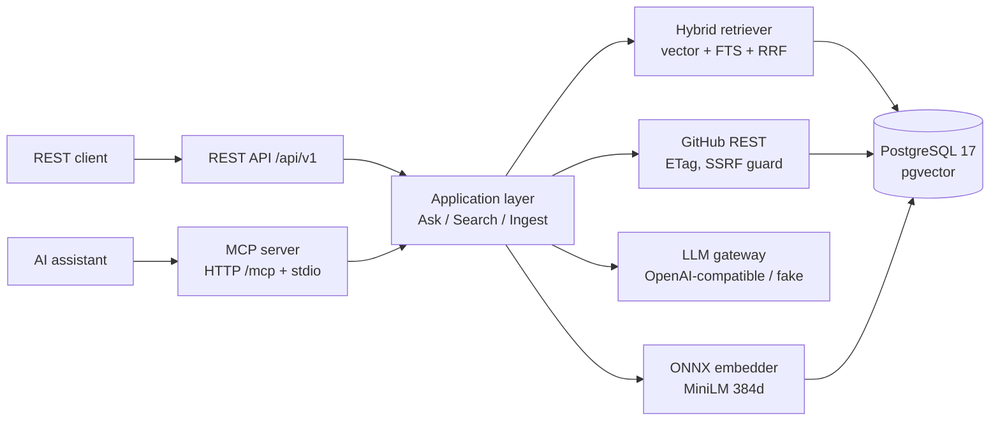

# RepoLens

[](https://github.com/vishweshpenkar06/RepoLens/actions/workflows/ci.yml)
[](LICENSE)
[](https://openjdk.org/projects/jdk/25/)
[](https://spring.io/projects/spring-boot)

Self-hosted Java service that ingests a GitHub repository's documentation and issues, then answers
questions about it with verified citations via a REST API and an MCP server for AI assistants.

> Status: v0.1.0 release candidate. Image, CI publish, deploy configs and docs are complete; the
> public demo URL awaits a host/domain and an LLM provider key.
> See `PROGRESS.md` and `MASTERPLAN.md`.

## Stack

Java 25 · Spring Boot 4.1.2 · Spring AI 2.0.2 · PostgreSQL 17 + pgvector 0.8.7 · Flyway ·
Caffeine · Micrometer/Prometheus/Grafana · Testcontainers · k6.

Exact versions and rationale: `docs/DECISIONS.md`.

## Quickstart

Prerequisites: JDK 21+ (25 recommended), Docker with the compose plugin.

Full stack (app + Postgres/pgvector + Prometheus + Grafana):

```bash
cp .env.example .env
# set REPOLENS_API_KEY in .env
docker compose up -d
curl localhost:8081/actuator/health
```

For local experiments only, Compose falls back to `demo-key-change-me` when `REPOLENS_API_KEY` is
empty; set a real key before exposing anything.

Develop the app on the host against containerized Postgres:

```bash
cp .env.example .env
docker compose up -d postgres
./mvnw verify
REPOLENS_API_KEY=$(grep ^REPOLENS_API_KEY .env | cut -d= -f2) ./mvnw spring-boot:run
```

Local ports (non-default on purpose, see `docs/ENVIRONMENT.md`):

| Service | URL |
|---|---|
| App | http://localhost:8081 |
| Postgres | `localhost:55432` (`repolens`/`repolens`) |
| Prometheus | http://localhost:9090 |
| Grafana | http://localhost:3001 (admin/admin) |

## Architecture



## Authentication

All `/api/*` and `/mcp` requests need an API key. Set `REPOLENS_API_KEY` in `.env` before starting;
only its SHA-256 hash is stored. Example:

```bash
export REPOLENS_API_KEY=$(openssl rand -hex 32)
curl -s localhost:8081/api/v1/repos -H "X-API-Key: $REPOLENS_API_KEY"
```

## Try ingestion

```bash
# Register a repo (async). Returns 202 with repoId + jobId.
curl -s -X POST localhost:8081/api/v1/repos \
  -H "X-API-Key: $REPOLENS_API_KEY" \
  -H 'Content-Type: application/json' \
  -d '{"url":"https://github.com/octocat/Hello-World"}'

curl -s localhost:8081/api/v1/repos/1 -H "X-API-Key: $REPOLENS_API_KEY"
curl -s localhost:8081/api/v1/repos   -H "X-API-Key: $REPOLENS_API_KEY"

# Incremental re-index (ETag + content hash; unchanged docs are not re-embedded)
curl -s -X POST localhost:8081/api/v1/repos/1/reindex -H "X-API-Key: $REPOLENS_API_KEY"
```

Only `https://github.com/{owner}/{name}` is accepted. Ingestion covers the README, top-level
markdown, `docs/**/*.md`, and up to 300 issues (`GITHUB_ISSUES_ENABLED=false` to disable).
Embeddings are local ONNX (384 dims); the first run downloads the model (~90 MB) and caches it.

## Search

```bash
# Hybrid search: vector + full-text, fused with Reciprocal Rank Fusion (k = 60).
curl -s "localhost:8081/api/v1/repos/1/search?q=docker+compose&k=6" \
  -H "X-API-Key: $REPOLENS_API_KEY"
```

Each hit includes the snippet, source URL, fused score, and its 1-based rank in each retriever
(`null` when that retriever did not return it). `k` is clamped to 1..12.

## Ask

```bash
curl -s -X POST localhost:8081/api/v1/repos/1/ask \
  -H "X-API-Key: $REPOLENS_API_KEY" \
  -H 'Content-Type: application/json' \
  -d '{"question":"How do I run this?","topK":6}'
# -> { answer, citations[], refused, latencyMs, cached }

curl -N "localhost:8081/api/v1/repos/1/ask/stream?question=How+do+I+run+this%3F&topK=6" \
  -H "X-API-Key: $REPOLENS_API_KEY"
```

Answers are grounded, cite sources, and refuse when evidence is missing. The default LLM is a
deterministic fake (no key). For a real model set any OpenAI-compatible endpoint:

```bash
LLM_PROVIDER=openai           # or openrouter, groq, ollama, openai-compatible...
LLM_BASE_URL=https://api.openai.com/v1
LLM_API_KEY=...
LLM_MODEL=gpt-4o-mini
```

Ollama: `LLM_PROVIDER=ollama LLM_BASE_URL=http://localhost:11434/v1 LLM_MODEL=llama3.1`.

## MCP

Four tools are exposed over streamable HTTP (`/mcp`) and stdio. See `docs/MCP_SETUP.md` for the
Claude Desktop config and a generic client example. HTTP requests need `X-API-Key`.

## Demo and deploy

- Reproducible terminal demo: `./scripts/demo.sh` (see `docs/DEMO.md`).
- Deployment: `deploy/docker-compose.prod.yml` + Caddy on a small VPS (`deploy/README.md`);
  GHCR publishing is wired in CI on `main` and version tags.
- Claude Desktop / MCP clients: `docs/MCP_SETUP.md`.

## Documentation

- `docs/API.md` — endpoints, payloads, errors, headers, SSE events
- `docs/ARCHITECTURE.md` — components, data flow, failure modes
- `docs/DECISIONS.md` — ADRs
- `docs/ENVIRONMENT.md` — verified toolchain
- `docs/BACKLOG.md` — ideas outside the plan
- `MASTERPLAN.md` — the plan this project follows

## API (planned)

`/api/v1/repos`, `/repos/{id}/search`, `/repos/{id}/ask`, `/repos/{id}/ask/stream`, plus MCP tools
`list_repositories`, `search_docs`, `ask_repo`, `get_document`. All endpoints require `X-API-Key`.

## Results

Measured on this machine (see `docs/EVAL.md`, `docs/BENCHMARKS.md` for methodology and caveats):

| Metric | Result |
|---|---|
| Retrieval hit@6 (hybrid RRF) | **92.5%** vs 85.0% vector-only, 65.0% keyword-only |
| Retrieval MRR@6 (hybrid) | 0.765 |
| Search throughput (200 VUs) | ~274 req/s, p95 664–804 ms |
| `/ask` cache hit vs bypass (fake 300 ms LLM) | **808 vs 53 req/s**, p95 6 vs 400 ms |
| Retrieval p95 | vector 156.6 ms, keyword 134.2 ms, fusion ≤1 ms |
| Ingestion (301 docs / 319 chunks) | 12.03 s at embedding concurrency 2 |

Evaluation: 52 cases over `encode/httpx` and `Kludex/starlette` plus an injection fixture.
Answer-quality metrics with a real model are pending a provider key; the harness and structural
checks are in place.

## Limitations

- Answer quality and real-provider prompt-injection resistance are unmeasured until an API key is
  configured; retrieval metrics are real, answer metrics are structural (see `docs/EVAL.md`).
- Rate limiting and caches are per node; Redis is the stretch goal for multi-node.
- Issue ingestion is capped at 300; `get_document` is capped at 20,000 characters.
- Benchmarks are single runs on a shared desktop; see `docs/BENCHMARKS.md`.
- The six human checkpoints were delegated to the agent (ADR-0016); do not present them as
  human-written without review.

## Roadmap

Cross-encoder reranker measured in eval; Redis-backed limiter/cache; GitHub webhook re-index; a
single static chat page (SSE); GraalVM native image; OpenTelemetry traces. See `docs/BACKLOG.md`.

## License

MIT — see [LICENSE](LICENSE).
